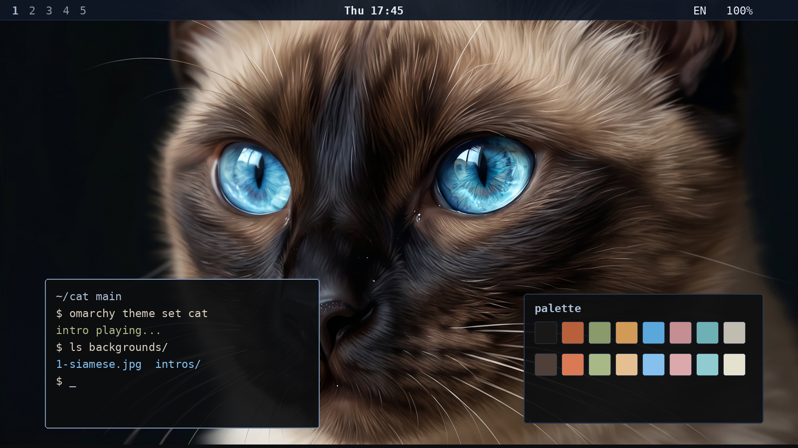

<h1 align="center">Cat</h1>

<p align="center">
  A dark <a href="https://omarchy.org">Omarchy</a> theme about cats.<br>
  Near-black base, steel-blue accent, and a palette picked straight from six painted cat wallpapers.
</p>

<p align="center">
  
</p>

<p align="center"><sub>Preview is a mockup built from the wallpaper and the palette, not a real screenshot.</sub></p>

## Highlights

- **Cat palette**: every color comes from one of the cats (see the table below)
- **Steel-blue accent** `#7b93b3` with a lighter `#aebfd6` cursor and a deep-blue selection `#26364f`, for a cool, metallic feel
- **Readable top bar**: navy bar background with light text (see [Top bar](#top-bar))
- **Six painted wallpapers**, with the Siamese as the main one
- **Animated intro** for the Siamese wallpaper: a warm golden light washes across the face and passes
- Dark by design: background `#0c0d0f`

## Wallpapers

<p align="center">
  
</p>

| File | Cat | Intro |
|---|---|---|
| `1-siamese.jpg` | Siamese, close-up with blue eyes (main) | yes |
| `2-calico.jpg` | Calico on an armchair by the window | no |
| `3-orange.jpg` | Orange tabby playing with teal yarn | no |
| `4-tabby.jpg` | Sleeping tabby on a gray blanket | no |
| `5-gray.jpg` | Gray cat watching the rain | no |
| `6-black.jpg` | Black cat asleep on a lap | no |

All wallpapers are 2576x1438. Cycle through them with `omarchy theme bg next`.

## Animated intro

<p align="center">
  
</p>

`backgrounds/intros/1-siamese.mp4` (7.5 s, 2576x1438, 24 fps, H.264). A warm, golden light washes across
the Siamese's face from left to right and passes, while the camera eases back and settles. The last frame
is the wallpaper itself, so the hand-off from video to still is seamless.

The GIF above is a lower-quality version for this page. Intros play at boot, on theme switch and when
picking the background. To turn them off: `omarchy theme bg intro disable`.

## Palette

<p align="center">
  
</p>

| Role | Color | Where it comes from |
|---|---|---|
| background | `#0c0d0f` | the dark backdrop around the Siamese |
| foreground | `#d9cfc0` | cream fur and knitted blankets |
| accent | `#7b93b3` | the gray cat's coat, pushed toward a deeper steel blue so it stands out |
| cursor | `#aebfd6` | lighter steel highlight |
| selection | `#26364f` | deep blue for selected text and rows |
| muted | `#6b6a60` | shadows on the gray cat's coat |
| bar background / text | `#0f1724` / `#e8eef7` | navy bar with near-white text (`shell.bar.toml`) |
| color1 / color9 | `#b8603c` / `#d97a55` | calico rust |
| color2 / color10 | `#8a9a6a` / `#a8b887` | the fern and pothos in the calico wallpaper |
| color3 / color11 | `#d19a57` / `#e5bf91` | orange tabby fur |
| color4 / color12 | `#5aa7dc` / `#86c0ec` | the Siamese's blue eyes |
| color5 / color13 | `#c58e92` / `#dba9ac` | paw pads and noses |
| color6 / color14 | `#6fb0b5` / `#8fcbcf` | teal yarn |
| color0 / color8 | `#1a1816` / `#4e4038` | black cat and Siamese seal brown |
| color7 / color15 | `#c0bcb0` / `#e5e1cf` | pale fur |

## Top bar

The Omarchy top bar can be transparent (`clear`), `glassy` or `opaque`, and that choice is yours, not the
theme's. With a transparent bar the clock and icons sit directly on the wallpaper, and on the Siamese's pale
fur at the top center they become hard to read. This theme ships a navy bar background with near-white text
(`shell.bar.toml`), which shows up in the `glassy` and `opaque` modes. **Double-click the bar to cycle
clear, glassy and opaque** until you like it.

## Install

```bash
omarchy theme install https://github.com/psychokk/omarchy-cat-theme
omarchy theme set cat
```

## What's inside

```
colors.toml                    # palette (terminal, shell, launcher, notifications, lock screen, btop, ...)
shell.bar.toml                 # top bar colors
backgrounds/
  1-siamese.jpg ... 6-black.jpg
  intros/1-siamese.mp4         # animated intro for the main wallpaper
preview.png
images/                        # pictures used by this README
```

## Make it yours

- **Add a wallpaper**: drop a `.jpg` or `.png` into `backgrounds/`. It shows up in `omarchy theme bg next`.
- **Add an intro**: put an `.mp4` with the same base name in `backgrounds/intros/`
  (for example `backgrounds/4-tabby.jpg` and `backgrounds/intros/4-tabby.mp4`). Wallpapers without
  an intro are simply shown as stills.
- **Change the accent**: edit `accent`, `cursor` and `selection` in `colors.toml`.
- **Change the top bar**: edit `background` and `text` in `shell.bar.toml`.

## Credits

Wallpaper artwork provided by the theme author. The intro animation is generated from the Siamese
wallpaper itself.

## Status

The theme follows the documented Omarchy layout but has not been verified on a live install yet.
If something looks off, please open an issue.
